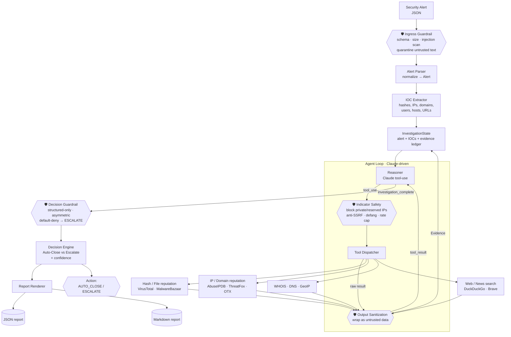
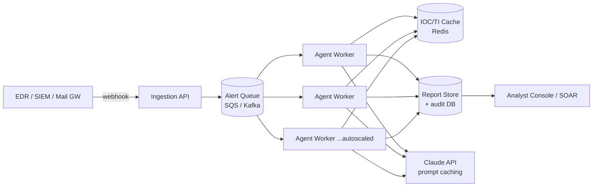

# Bond — AI Security Analyst · Architecture

> An autonomous AI agent that investigates a security alert the way a Tier-1 SecOps
> analyst would: extract indicators, query threat-intel and OSINT tools, reason over
> the evidence, and reach a defensible verdict — **Auto-Close** or **Escalate** — with
> a structured, sourced report.

---

# Page 1 — Current System Design

## 1. Overview

Bond is triggered by a single security **alert** (JSON) and is responsible for one
contract:

> *Given an alert, autonomously gather enough context to either safely **close** it
> (false-positive / benign) or **escalate** it to a human with an actionable, evidence-backed report.*

The loop is powered by the **Claude API** using native **tool-use**: Claude decides
which indicators matter, which tools to call, and when it has seen enough to conclude.
Bond is model-driven in its *reasoning* but deterministic in its *control flow*,
state handling, and output schema — the parts that must be reliable in a SOC.

## 2. System Diagram

> 🛡️ = a **guardrail / trust boundary** (see §5). Untrusted data is sanitized at every
> point it enters the model's context, and the system always fails *safe* (toward escalation).



<details>
<summary>ASCII fallback (if Mermaid doesn't render)</summary>

```
 Alert(JSON) -> [GUARD: ingress] -> Alert Parser -> IOC Extractor -> State
                                                                       |
        +--------------------- Agent Loop ------------------+----------+
        | Reasoner (Claude) <-tool_result- [GUARD: output]  |  Tool    |
        |     |  -tool_use-> [GUARD: indicator safety] -->  | Dispatch |
        +-----|----------------------------------------|----+----------+
              |                                         v
              |                          [Hash rep][IP/Domain rep]
              |                          [WHOIS/DNS/Geo][Web search]
              |                                         | (-> GUARD: output)
              |                          Evidence appended to State
              v
   investigation_complete -> [GUARD: decision / default-deny] -> Decision Engine
                                          -> Report (JSON + MD)
                                          -> Action: AUTO_CLOSE | ESCALATE
```
</details>

## 3. Component Walkthrough

| Component | Responsibility |
|---|---|
| **Guardrail layer** 🛡️ | Cross-cutting trust-boundary enforcement (`src/guardrails.py`) invoked at ingress, before each tool call, on every tool result, and at the final decision. Detailed in §5. |
| **Alert Parser** | Validates and normalizes the raw alert into a typed `Alert` (id, type, severity, entities, raw payload preserved for the report). |
| **IOC Extractor** | Pulls indicators (file hashes, IPs, domains, URLs, hostnames, users) from the alert's structured entities into a de-duplicated `IOC` list — the agent's starting work-list. |
| **Agent Loop** | The Claude-driven reason→act cycle. Claude sees the alert + accumulated evidence each turn and either requests a tool or signals completion. |
| **Tool Dispatcher** | Maps Claude's `tool_use` blocks to Python tool functions, enforces JSON schemas, and returns `tool_result`. Each tool returns **real** data if its API key is present, else a realistic **mock** — so Bond always runs. |
| **Decision Engine** | Forced via a structured `investigation_complete` tool call: produces the action, confidence, findings summary, rationale, sources, and next steps. |
| **Report Renderer** | Serializes the final `InvestigationReport` to both JSON (machine) and Markdown (human). |

## 4. Agent Implementation

### 4.1 State management
A single typed `InvestigationState` object is the backbone (`src/models.py`). It holds
the normalized `Alert`, the de-duplicated `IOC` list, an **append-only evidence ledger**
(`Evidence` objects, each tagged with tool, query, disposition, source URL, a
`is_mock` flag, and a timestamp), and a `step` counter. The dispatcher appends evidence;
the reasoner reads it back on the next turn. Because state is plain dataclasses, the
*entire investigation is serializable* — critical for auditability, replay, and the
scaling story on page 2.

### 4.2 Reasoning
Claude drives the loop via **native tool-use**. A system prompt frames Bond as a
disciplined Tier-1 analyst with explicit, non-negotiable decision criteria:

- **Never Auto-Close** an alert without corroborating evidence that the indicators are benign.
- **When uncertain, Escalate** — a false negative (missed true threat) is far costlier than a false positive.
- **Cite every claim** to the tool/source that produced it.

Each turn Claude either emits a `tool_use` request (continue investigating) or calls the
terminal `investigation_complete` tool (conclude). The model decides *which* IOCs are
worth enriching and *when* the picture is complete — that's the "thinking like an analyst" part.

### 4.3 Tool execution
Tools are registered with strict JSON input schemas and exposed to Claude in the
`tools` parameter. The dispatcher:

1. Receives a `tool_use` block, validates inputs against the schema.
2. Routes to the tool's `run()` — which attempts the live API and **falls back to a mock** on missing key / error / rate-limit.
3. Wraps the result as `Evidence` (with `is_mock` flag + source) and as a `tool_result` block returned to Claude.

Tool failures are returned as structured errors, not exceptions, so the agent can adapt
(try another tool, or conclude with lower confidence) rather than crash.

### 4.4 Termination & fail-safe
The loop ends when Claude calls `investigation_complete`, **or** when the
`BOND_MAX_STEPS` budget is exhausted. Budget exhaustion forces an **Escalate** verdict
with `Low` confidence — Bond never silently closes an alert it couldn't finish investigating.

## 5. AI Security & Guardrails (Trust Boundaries)

An autonomous agent that ingests attacker-influenced data and then *voluntarily fetches
more of it* (WHOIS records, web pages, search snippets) is a prime target for **prompt
injection**. The adversary's goal here is asymmetric and specific: **flip an `ESCALATE`
into an `AUTO_CLOSE`** so a real attack is dismissed as benign. Bond therefore treats
every point where untrusted data enters the model's context as a **trust boundary** and
enforces a guardrail there — defense-in-depth that always fails *safe* (toward
escalation), never *open*.

| # | Guardrail | Boundary | What it enforces |
|---|---|---|---|
| 1 | **Ingress validation** | alert → loop | Strict schema + size caps; **two-stage injection detection** (see below) on free-text fields; all alert text quarantined inside `<untrusted_data>` delimiters (spotlighting) so the model reads it as data, never instructions. |
| 2 | **Indicator safety / anti-SSRF** | before tool calls | Refuse active lookups against private / reserved / internal IPs and the cloud metadata endpoint (`169.254.169.254`); defang URLs; cap IOC count to bound cost and resource exhaustion. |
| 3 | **Tool-output sanitization** | tool result → loop | All tool output (especially fetched web / WHOIS content) re-enters context wrapped as untrusted data, and is run through the same two-stage injection detector before ingestion. |
| 4 | **Decision guardrail** | loop → verdict | Verdict only via the structured `investigation_complete` tool — no free-form close. **Asymmetric:** an `AUTO_CLOSE` requires ≥N independent benign signals plus an injection self-check. **Default-deny:** any tripped guardrail or budget exhaustion forces `ESCALATE`. |
| 5 | **Prompt hardening** | system prompt | Explicit data-vs-instruction separation; Bond is told to **report any embedded instructions it finds as a security finding**. |
| 6 | **Data minimization** | tool layer | Only the specific indicator (a hash, an IP) is sent to third-party APIs — never the raw alert or its PII. |

**Two-stage injection detection.** Untrusted text (at ingress and on every tool result)
passes through a fast **heuristic pre-filter** (deterministic regex over known
injection phrasings — cheap, explainable, catches the obvious) and then an **LLM-based
classifier** running on a small, fast model (e.g. Claude Haiku, separate from the main
reasoning loop) that judges whether a span is attempting to hijack instructions. The
heuristic gives speed and auditability; the LLM stage catches paraphrased, obfuscated, or
novel attacks the regex set misses. Either stage firing yields a finding.

**Key principle — injection is a signal, not just noise.** A prompt-injection attempt
embedded in an alert or IOC is *itself evidence of malicious intent*. Bond does not
silently strip it; it records `"embedded instruction detected in <field>"` as a finding
that pushes the verdict toward **ESCALATE**. The guardrail doubles as a detector.

**Framework alignment.** These map to the **OWASP Top 10 for LLM Applications**:
LLM01 Prompt Injection (guardrails 1, 3, 5), LLM02 Insecure Output Handling (3),
LLM06 Sensitive Information Disclosure (6), and LLM08 Excessive Agency (2, 4).
Implemented as a dedicated `src/guardrails.py` invoked at each boundary above.

---

# Page 2 — Future Development & Vision

## 6. Scaling to hundreds of alerts/day

The single-process CLI is the seed of a horizontally-scalable service. The key enabler is
a property of the design itself: **each investigation is independent and fully
serializable** — everything Bond needs lives in the `InvestigationState` for that one
alert, with no shared memory between alerts. That means scaling isn't a rewrite; it's
wrapping the same engine in a queue and running many copies of it at once.



**The levers — what each one is, and why it matters:**

- **Queue-based ingestion — absorb spikes.** Alerts land in a queue (SQS / Kafka) instead
  of hitting Bond directly; workers *pull* at their own pace. If 500 alerts arrive in one
  minute, nothing falls over — they wait in line. The queue is a shock absorber that
  decouples how fast alerts *arrive* from how fast we *process* them.

- **Stateless autoscaled workers — add throughput by adding boxes.** Bond runs in
  containers (K8s / ECS); each handles one investigation. A scheduler spins up more
  workers when the queue gets deep and kills them when it drains. Because workers share no
  state, *any* worker can take *any* alert — so going from 10 → 1,000 alerts/day is just
  "run more workers."

- **Prompt caching — turn a per-alert cost into a one-time cost.** Bond's **system prompt
  and tool definitions are byte-identical for every alert** (the analyst persona, decision
  criteria, guardrail rules, and tool schemas never change). The Claude API can cache that
  large static prefix: the *first* request processes it at full price (~1.25×), and every
  request after — read at ~0.1× — barely pays for it again. This pays off **twice**:
  *within* one alert (Bond's loop is multi-turn, so the prefix is reused on every reasoning
  step) and *across* alerts (the same prefix is shared by every alert that arrives inside
  the cache TTL). The one rule the implementation must honor: keep that prefix **truly
  static** — no timestamps, request IDs, or per-alert data in the system prompt, and a
  deterministic tool order — or the cache silently misses and we pay full price every time.

- **Shared IOC/TI cache (Redis) — don't look the same thing up twice.** The same malicious
  hash or IP shows up across many alerts (one attacker, many victims). Caching reputation
  results with a TTL means we don't re-query for indicators we've already seen — which
  saves money *and* protects our free-tier API quotas from running dry under load.

- **Rate-limit & cost governance — stay within budget and within quota.** Per-provider
  token buckets keep us under each free-tier API's limit (hammer them and they ban us); a
  per-alert token/$ budget caps how expensive any single investigation can get; and a cheap
  triage pre-filter (see §7) handles obvious noise before the expensive loop ever runs.

- **Idempotency & dedup — investigate once, not 300 times.** During a real incident an EDR
  fires the *same* detection over and over. Hashing incoming alerts collapses duplicates
  and alert storms into a single investigation instead of hundreds.

**In one breath:** the *queue + stateless workers* give horizontal scale; *prompt caching +
the TI cache + dedup + budgets* keep that scale cheap and stop it from melting the
downstream APIs.

This is the maturity arc: how Bond grows from a *read-only, single-alert triager* into a
*correlated, action-capable, self-improving investigator* — each step moving it closer to
what a senior analyst (and eventually a whole SOC) actually does.

- **Richer tool set — more senses, and hands.** Today Bond *reads* threat intel; next it
  acts like an analyst who pivots deeper:
  - *Sandbox detonation* — reputation lookups answer "malicious?" only for *known* files.
    For a **zero-day / never-seen** file they go silent, which is exactly when you worry
    most. Detonation runs the unknown file in an isolated VM and watches what it does
    (calls home? encrypts files? injects?) — the gold standard when lookups come up empty.
  - *Live SIEM/EDR queries* — instead of judging the single JSON snapshot it was handed,
    pull the **host's full timeline**: what spawned the process, what else fired on that
    machine, the user's recent logins. Context instead of isolation.
  - *Identity / asset graph* — turn entity strings into **blast radius**. "This user is a
    domain admin" or "this host is a domain controller" should massively raise severity;
    the same alert means very different things depending on who/what it touches.
  - *SOAR actions* — today Bond only *decides*; next it can *act* (isolate the host,
    disable the account, block the IP). This crosses from **analyst → responder**, so these
    high-stakes, hard-to-reverse actions stay behind the human-approval gate.

- **Triage pre-filter — don't spend a senior analyst on junk.** At hundreds of alerts/day
  most are obvious false positives. A fast, cheap model (e.g. Haiku) screens each alert
  first and drops the obvious noise, reserving Bond's expensive deep-reasoning loop for the
  genuinely *ambiguous* alerts that need it. Both a focus win and a cost lever (the
  cheap-model-in-front idea from §6).

- **Human-in-the-loop feedback — the flywheel.** Every time an analyst **overrides** Bond
  (it auto-closed something they re-opened, or escalated something clearly benign), capture
  that disagreement as **labeled data**. Over time it becomes the training/eval signal that
  drives accuracy up — the mechanism by which Bond *learns from its own mistakes*. Without
  it, Bond never improves; with it, every correction sharpens the next investigation. Feeds
  directly into the testing strategy in §8.

- **Correlation across alerts — see the campaign, not the fragment.** Real attacks fire
  *many* alerts (malware detection → suspicious login → lateral movement). Investigating
  each in isolation misses the story. Grouping related alerts into a single **incident**
  investigation lets Bond connect the dots the way a good analyst does.

- **Confidence calibration & stronger guardrails — make verdicts trustworthy.** Tighten
  *when* Bond may be confident or close: require **N independent malicious signals** before
  a "High confidence" verdict, and add an adversarial self-check specifically on
  **Auto-Close** ("could I be wrong to close this?"). Extends the asymmetric, fail-safe
  philosophy from §5 — the most dangerous decision earns the most scrutiny.

**The throughline** — Bond evolves along five axes:

| Axis | From → To |
|---|---|
| **Senses & hands** | reads intel → detonates, queries live systems, takes action |
| **Resource use** | full loop on everything → cheap triage filters noise first |
| **Learning** | static → improves from every analyst override |
| **Scope** | one alert at a time → correlated incidents |
| **Trust** | fixed thresholds → calibrated, self-checked confidence |

Net: **a passive single-alert triager becomes an active, context-aware, continuously-improving SOC analyst.**

## 8. Testing & accuracy strategy

The core risk in an auto-closing agent is **false negatives** (closing a real threat).
Testing is built to drive those toward zero while keeping false positives manageable.

- **Labeled alert corpus:** a growing fixture set of alerts with known ground-truth dispositions (TP/FP) spanning every alert type, including adversarial edge cases.
- **Regression harness:** run the full corpus through Bond on every change; measure **precision/recall on the Auto-Close decision** and track a **confusion matrix**. Gate merges on "zero new false negatives."
- **Deterministic tool mocks** make these runs reproducible and offline — the same alert yields the same evidence, so accuracy regressions are attributable to prompt/logic changes, not API flakiness.
- **LLM-as-judge** scores report quality (is the rationale sound? are claims sourced? is the summary faithful to the evidence?) separately from the binary decision.
- **Asymmetric thresholds:** Auto-Close requires a higher evidentiary bar than Escalate; we tune toward recall on the malicious class even at some precision cost.
- **Shadow mode before autonomy:** in production, run Bond alongside human analysts and compare verdicts before granting it authority to actually close alerts.
